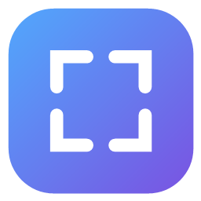

<div align="center">



# Nuvo

### A screenshot tool straight from Mac, only on Windows.

Press <kbd>PrtScr</kbd>, select, mark up — and get a beautiful screenshot in your clipboard.


**English** · [Русский](README.ru.md)

</div>

<br>

## Features

- **Global <kbd>PrtScr</kbd>**: Nuvo takes the key over from Snipping Tool.
- **Three selection modes**: area, window (hover to highlight, click to pick) or the whole desktop, including multiple monitors.
- **Markup**: arrow, rectangle and line, with a color picker and <kbd>Ctrl</kbd>+<kbd>Z</kbd> to undo.
- **Beautiful background**: 8 macOS-style gradients or your own color, with a rounded, shadowed card for the screenshot.
- **Instantly in the clipboard**: copied automatically after every change. A PNG is placed there, so transparency survives in browsers and messengers.
- **Save as PNG**: the save button or <kbd>Ctrl</kbd>+<kbd>S</kbd>, files go to `Pictures\Nuvo`.
- **Dark UI**, tray icon, settings window (click the tray icon) and optional autostart.

## Shortcuts

| Key | Action |
| --- | --- |
| <kbd>PrtScr</kbd> | Start a screenshot |
| <kbd>Ctrl</kbd>+<kbd>Z</kbd> | Undo the last mark |
| <kbd>Ctrl</kbd>+<kbd>S</kbd> | Save as PNG and close |
| <kbd>Esc</kbd>, <kbd>Enter</kbd> or right click | Close the overlay |

## Build

Requires Windows 10/11 and the [.NET 8 SDK](https://dotnet.microsoft.com/download/dotnet/8.0).

```bash
dotnet build -c Release
```

Run `bin\Release\net8.0-windows\Nuvo.exe`. To publish a single self-contained file:

```bash
dotnet publish -c Release -r win-x64 --self-contained -p:PublishSingleFile=true
```

## Font

The UI uses Google Sans when available. Drop the `.ttf` files into the `Fonts` folder before building; otherwise Nuvo falls back to Segoe UI. Font files are not part of the repository.

## Notes

- Transparent corners around the card survive in PNG-aware apps. Apps that ignore alpha, such as Paint, get a copy flattened on white.
- Settings are stored in `%AppData%\Nuvo\settings.json`.

<br>

<div align="center">

Made with care for Windows.

</div>
