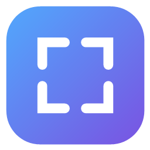

<div align="center">



# Nuvo

### Скриншотер прямиком из Mac, только на Windows.

Нажмите <kbd>PrtScr</kbd>, выделите, отметьте главное — и получите красивый скриншот в буфере обмена.


[English](README.md) · **Русский**

</div>

<br>

## ✨ Возможности

- 🖥️ **Глобальный <kbd>PrtScr</kbd>**: Nuvo перехватывает клавишу у Snipping Tool.
- 🎯 **Три режима выделения**: область, окно (наведите, чтобы подсветить, и кликните) или весь рабочий стол, включая несколько мониторов.
- ✏️ **Разметка**: стрелка, прямоугольник и линия, выбор цвета и <kbd>Ctrl</kbd>+<kbd>Z</kbd> для отмены.
- 🎨 **Красивый фон**: 8 градиентов в стиле macOS или свой цвет, скриншот лежит на скруглённой карточке с тенью.
- 📋 **Сразу в буфере обмена**: копируется автоматически после каждого изменения. В буфер кладётся PNG, поэтому прозрачность сохраняется в браузерах и мессенджерах.
- 💾 **Сохранение в PNG**: кнопка сохранения или <kbd>Ctrl</kbd>+<kbd>S</kbd>, файлы попадают в `Pictures\Nuvo`.
- 🌙 **Тёмный интерфейс**, иконка в трее, окно настроек (клик по иконке) и необязательный автозапуск.

## ⌨️ Горячие клавиши

| Клавиша | Действие |
| --- | --- |
| <kbd>PrtScr</kbd> | Начать скриншот |
| <kbd>Ctrl</kbd>+<kbd>Z</kbd> | Отменить последнюю отметку |
| <kbd>Ctrl</kbd>+<kbd>S</kbd> | Сохранить в PNG и закрыть |
| <kbd>Esc</kbd>, <kbd>Enter</kbd> или правый клик | Закрыть оверлей |

## 🛠️ Сборка

Нужны Windows 10/11 и [.NET 8 SDK](https://dotnet.microsoft.com/download/dotnet/8.0).

```bash
dotnet build -c Release
```

Запустите `bin\Release\net8.0-windows\Nuvo.exe`. Чтобы собрать один самодостаточный файл:

```bash
dotnet publish -c Release -r win-x64 --self-contained -p:PublishSingleFile=true
```

## 🔤 Шрифт

Интерфейс использует Google Sans, если он есть. Положите `.ttf` в папку `Fonts` перед сборкой, иначе Nuvo возьмёт Segoe UI. Файлы шрифтов в репозиторий не входят.

## 📝 Заметки

- Прозрачные углы вокруг карточки сохраняются в приложениях, которые понимают PNG. Приложения, игнорирующие прозрачность, например Paint, получают копию на белом фоне.
- Настройки хранятся в `%AppData%\Nuvo\settings.json`.

<br>

<div align="center">

Сделано с любовью для Windows.

</div>
